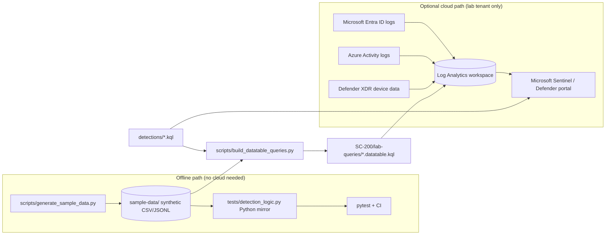

# microsoft-security-labs

Hands-on, original learning labs for **Microsoft security** fundamentals, **security operations (SOC)** and **cloud + AI workload security**, aligned to the topic areas of the **SC-900**, **SC-200** and **SC-500** certifications.

Author: **Syed Salman Ali** – SOC Analyst, Senior Microsoft Student Ambassador, Lead of the Microsoft Campus Club at SMIU.

> **Read this first – honesty statement.**
> Every dataset here is **synthetic** (reserved `contoso.example` domain, RFC 5737 documentation IPs). All KQL passes Microsoft's open-source Kusto language parser (syntax; plus semantic checks on the self-contained learner versions) and its logic is mirrored and tested in Python. **No query in this repository has been executed in a live Microsoft Sentinel or Defender tenant by the author yet.** Each artifact carries one of the labels defined in [docs/verification-matrix.md](docs/verification-matrix.md). This is not exam-dump material and it is not affiliated with or endorsed by Microsoft.

## Who this is for
- Junior SOC analysts and students who want to practise reading logs and writing detections.
- Learners preparing for SC-900 / SC-200 / SC-500 who want *practical* understanding, not memorisation.
- Community contributors who want to improve small, well-tested detection and lab content.

## What you will learn
| Track | Outcome |
|---|---|
| [SC-900](SC-900/README.md) | Explain security, identity, authentication vs authorization, MFA and Conditional Access, and trace a sign-in decision using a small simulator. |
| [SC-200](SC-200/README.md) | Investigate a synthetic account-compromise incident with KQL: scope, timeline, detections, and a written incident report. |
| [SC-500](SC-500/README.md) | Apply cloud and AI workload controls: policy-as-code, storage hardening (Bicep), privileged access, AI service monitoring. |

## Prerequisites
- Basic networking and Windows/Linux knowledge; no prior KQL needed (a primer is in the SC-200 lab).
- **Offline path (free):** Python 3.10+ and `pytest`. Run every simulation and test with no cloud account.
- **Cloud path (optional):** an Azure subscription and a Log Analytics workspace (a Microsoft Sentinel workspace is optional). Use only lab tenants – never run lab content against production.

## Quick start
```bash
git clone https://github.com/<your-username>/microsoft-security-labs.git
cd microsoft-security-labs
pip install -r requirements-dev.txt
pytest -q
```
To try the KQL without ingesting anything, paste any file from [`SC-200/lab-queries/`](SC-200/lab-queries) into a Log Analytics query window; each embeds the synthetic rows using the `datatable` operator.

## Architecture

More detail: [docs/architecture.md](docs/architecture.md).

## Navigation
| Path | Contents |
|---|---|
| [SC-900/](SC-900/README.md) | Concept guide + Conditional Access teaching simulator |
| [SC-200/](SC-200/README.md) | Incident-investigation lab, KQL primer, runnable learner queries |
| [SC-500/](SC-500/README.md) | Four labs: Azure Policy, storage hardening (Bicep), privileged access, AI workload security |
| [detections/](detections/README.md) | Six documented KQL detections with assumptions and limitations |
| [sample-data/](sample-data/README.md) | Clearly labelled synthetic datasets |
| [tests/](tests) | pytest suite (logic, lab artifacts, repo quality, secret scan) |
| [docs/](docs) | Architecture, official references, verification matrix, glossary, publishing guide |

## Product-name note
Microsoft renames products often. This repo uses **Microsoft Entra ID** (formerly Azure Active Directory), **Microsoft Defender XDR** and **Microsoft Sentinel**. Microsoft has announced that managing Sentinel in the Azure portal will sunset on **31 March 2027**, with Sentinel then available only in the Microsoft Defender portal (see [references](docs/references.md)). Check the official docs for current status before relying on any portal steps.

## Contributing & security
See [CONTRIBUTING.md](CONTRIBUTING.md) and [SECURITY.md](SECURITY.md). Licensed under the [MIT License](LICENSE).
