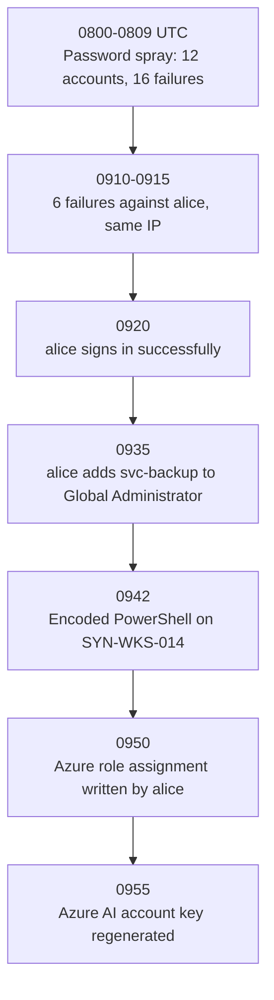

# SC-200 Track – Security Operations Lab (KQL, Investigation, Detection, Incident Analysis)

**Level:** beginner → intermediate. **Scenario:** a fully **synthetic** account-compromise incident at the fictional *Contoso Synthetic Corp*.
**Status labels:** 🧪 **SIMULATED** – logic verified offline in Python on synthetic data. ⚠️ **Not run in a live Microsoft Sentinel tenant by the author.** If you run a query in your own lab, please share the result via an issue so the label can be upgraded honestly.

Official context: [SC-200 study guide](https://learn.microsoft.com/credentials/certifications/resources/study-guides/sc-200) · [KQL overview](https://learn.microsoft.com/kusto/query/) · [Microsoft Sentinel overview](https://learn.microsoft.com/azure/sentinel/overview)

## How to run the lab
**Option A – no setup (recommended first):** open a Log Analytics query window (Azure Monitor → Logs, or a Sentinel workspace *Logs* page; any workspace works because `datatable` needs no tables) and paste a file from [`lab-queries/`](lab-queries). Each file embeds the synthetic rows.
**Option B – offline:** `pytest -q tests/test_detections.py` runs Python mirrors of the same logic.
**Option C – real ingestion (advanced, lab only):** ingest the CSVs from [`sample-data/`](../sample-data/README.md) into a custom table, then adapt the production versions in [`detections/`](../detections/README.md). Never mix synthetic rows into a production workspace.

## KQL primer for juniors
| Operator | Meaning | Example |
|---|---|---|
| `where` | Keep rows that match | `where ResultType == "50126"` |
| `summarize ... by` | Group and aggregate | `summarize count() by IPAddress` |
| `dcount()` | Count of *distinct* values | `dcount(UserPrincipalName)` |
| `bin(t, 10m)` | Round time to 10-minute buckets | `by bin(TimeGenerated, 10m)` |
| `join kind=inner` | Combine two tables on shared keys | failures ⨝ successes |
| `project` | Choose output columns | `project TimeGenerated, Caller` |
| `extend` | Add a computed column | `extend Actor = tostring(...)` |
| `mv-expand` | Split an array into rows | `mv-expand prop = ...modifiedProperties` |
| `let` | Name a value or sub-query | `let minFailures = 10;` |
| `ago(1d)` | "One day before now" | `where TimeGenerated > ago(1d)` |

`SigninLogs`: `ResultType == "0"` means success; `"50126"` means invalid username or password (see [Entra sign-in error codes](https://learn.microsoft.com/entra/identity-platform/reference-error-codes)).
> In the **Defender portal Advanced Hunting**, the time column is `Timestamp`, and some tables differ from the Log Analytics versions. Always check the schema of the surface you query.

## The scenario (all data synthetic, UTC, 10 Jan 2026)

## Investigation walkthrough
Work through the steps; each lists the query file, the **expected result on the synthetic data**, and the thinking behind it. (Expected values are enforced by `tests/test_detections.py`.)

### Step 1 – Triage: is there spraying? → `01_password_spray.datatable.kql`
*Thinking:* spraying = few attempts per account, across many accounts, from one source – it evades per-account lockouts.
**Expected:** 1 row – IP `203.0.113.10`, window start `08:00`, `FailedAttempts = 16`, `DistinctUsers = 12`.
**Limitations:** fixed bins can split an attack at a bin boundary; shared NAT IPs create false positives.

### Step 2 – Did any guessing succeed? → `02_success_after_failures.datatable.kql`
**Expected:** 1 row – `alice@contoso.example`, IP `203.0.113.10`, `Fails = 6`, last failure `09:15`, success `09:20`.
**Benign look-alike:** `bob` mistyped twice from `192.0.2.20` and then succeeded – *not* flagged because it is below the threshold. Why does the threshold matter? Because people mistype.

### Step 3 – What did the account do next? → `03`, `05`, `06`
- `03_privileged_role_assignment` – **Expected 2 rows:** (a) `it.admin` → `helpdesk.user`, *Security Administrator* at 07:30; (b) `alice` → `svc-backup`, *Global Administrator* at 09:35. Row (a) is a **candidate false positive** – an analyst checks the change ticket. Row (b) is acting from a compromised account and is high priority.
- `05_azure_rbac_assignment_unapproved` – **Expected 1 row:** `alice` at 09:50 from `203.0.113.10` (the `it.admin` write is on the approved list).
- `06_ai_service_key_regeneration` – **Expected 1 row:** `alice` at 09:55 – regenerating keys can be persistence *or* routine rotation; the unusual caller and IP decide.

### Step 4 – Endpoint evidence → `04_encoded_powershell.datatable.kql`
**Expected:** 1 row – device `SYN-WKS-014`, account `alice`, 09:42; parent process `winword.exe`. Plain `-File` and `-Command` PowerShell runs are not flagged.
**Analyst exercise:** a document application launching hidden, encoded PowerShell is suspicious, but the sign-in evidence points to password guessing – not a malicious document. Are these **one intrusion or two events**? Write down what extra evidence (email logs, file hash, process tree, EDR alerts) would settle it. *Good analysts do not claim a link the data does not prove.*

### Step 5 – Build the timeline and scope
Combine steps 1-4 (see the timeline above). Scope questions: other accounts the same IP touched (Step 1: 12 users), what privileged changes happened (Step 3), which device is involved (Step 4).

## MITRE ATT&CK mapping
| Observation | Technique |
|---|---|
| Spray across accounts | T1110.003 Password Spraying |
| Successful guess | T1110 Brute Force, T1078.004 Valid Accounts: Cloud Accounts |
| Added to Global Administrator | T1098.003 Additional Cloud Roles |
| Encoded PowerShell | T1059.001 PowerShell, T1027 Obfuscated Files or Information |
| AI key regeneration | T1098 Account Manipulation (analyst judgement) |

## Suggested response actions (always follow your organisation's IR process)
1. Contain: disable/reset `alice`, **revoke active sessions and tokens**, review registered MFA methods for attacker-added ones.
2. Reverse unauthorised change: remove `svc-backup` from Global Administrator; review what it did since 09:35.
3. Rotate Azure AI keys and any secrets the account could read; prefer managed identities and Entra ID auth over keys.
4. Endpoint: isolate `SYN-WKS-014` per policy, collect the process tree and decode the payload in a safe environment.
5. Prevent recurrence: phishing-resistant MFA, Conditional Access (see [SC-900](../SC-900/README.md)), smart lockout tuning, alerts from `detections/`.
Blocking the IP is a supplementary step only – attackers rotate IPs.

## Incident report (completed example on synthetic data)
| Field | Value |
|---|---|
| Title | Synthetic: Account compromise via password guessing with privilege escalation |
| Severity | High (privileged role granted) |
| Detection | Rules 01, 02, 03, 04, 05, 06 (offline-simulated) |
| Summary | A password spray (16 failures, 12 accounts) was followed by successful guessing of `alice`, a Global Administrator grant to `svc-backup`, an Azure RBAC write and AI key regeneration from the same source IP, plus encoded PowerShell on `SYN-WKS-014`. |
| Confidence | Identity chain: high. Link to endpoint event: **unconfirmed** (needs process-tree/email evidence). |
| Impact | Unknown – requires review of actions by `svc-backup` and Azure resources in `rg-lab-prod`, `rg-lab-ai`. |
| Next steps | Containment list above; widen hunt to the source IP across all tables. |

## Limitations of this lab
- Synthetic, tiny dataset – thresholds are for teaching, not production defaults.
- Real tenants have schema differences, noise, and legitimate edge cases that this data does not model.
- The Python mirrors prove the *logic*; only a run in a real workspace proves the KQL executes on real schemas.
