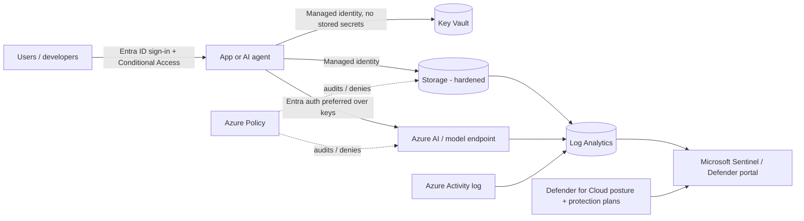

# SC-500 Track – Cloud and AI Workload Security Labs

SC-500 (*Implementing End-to-End Security Controls for Cloud and AI Workloads*) leads to the **Microsoft Certified: Cloud and AI Security Engineer Associate** certification. Per Microsoft's study guide it covers securing identities, data, networking, compute and **AI workloads**, plus posture management and monitoring with Microsoft Defender for Cloud and Microsoft Sentinel.

> 📌 Always check the live [official SC-500 study guide](https://learn.microsoft.com/en-us/credentials/certifications/resources/study-guides/sc-500) – the exam is new and its skills list can change. This track is original practice material, **not** exam content, and it intentionally does not reproduce skill weights (read them on the official page).

## Labs
| Lab | Topic area | Offline? | Verification label |
|---|---|---|---|
| [01 Governance with Azure Policy](labs/01-governance-azure-policy/README.md) | Governance, compliance, policy-as-code | ✅ simulator | 🧪 JSON structure + logic simulated; ⚠️ not deployed to a live subscription |
| [02 Data protection: hardened storage](labs/02-data-protection-storage/README.md) | Storage security, encryption in transit, auth | ✅ compile only | ✅ `bicep build` succeeded (CLI 0.48.1); ⚠️ not deployed |
| [03 Identity & privileged access](labs/03-identity-privileged-access/README.md) | Entra ID, PIM, RBAC, managed identities, Key Vault | ➖ checklist | 📚 conceptual; detection `05` simulated |
| [04 AI workload security](labs/04-ai-workload-security/README.md) | Securing AI apps/agents, monitoring | ➖ threat model | 📚 conceptual; detection `06` simulated |

## Reference architecture used across the labs

## How the labs map to skills (topic level)
- **Identity, access, governance** → labs 01, 03 (Entra roles, PIM, Azure RBAC, Azure Policy, regulatory-compliance evaluation in Defender for Cloud).
- **Storage, databases, networking** → lab 02 (secure transfer, TLS, anonymous access, shared-key access, network rules, soft delete).
- **Compute and AI security** → lab 04 (threat modelling an AI workload; Defender for AI services; Purview DSPM for AI; agent identity).
- **Posture and monitoring** → labs 03/04 plus [detections](../detections/README.md) 05 and 06.

## Cost and safety
Cloud steps may incur charges and change security settings. Use a **separate lab subscription**, set a budget alert, and delete resource groups afterward. Never run these labs in production or an employer's tenant. Commands are labelled *untested by the author* where applicable.
