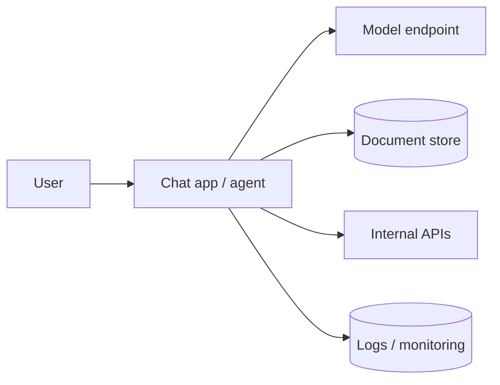

# Lab 04 – AI workload security (threat model + controls + monitoring)

**Goal:** learn to threat-model an AI application and map controls to Microsoft security capabilities.
**Docs (verify current names and availability):** [Defender for AI services threat protection](https://learn.microsoft.com/azure/defender-for-cloud/ai-threat-protection) · [Microsoft Purview DSPM for AI](https://learn.microsoft.com/purview/dspm-for-ai) · [SC-500 study guide](https://learn.microsoft.com/en-us/credentials/certifications/resources/study-guides/sc-500)

> AI security features and product names are changing quickly. The SC-500 study guide lists AI-security topics such as Defender for AI services, Purview DSPM, Microsoft Entra Agent ID and AI gateways. This lab stays at the threat-model/controls level; follow the official docs for exact configuration steps.

## Example workload
A chat app with an LLM endpoint, a document store and an agent that can call internal APIs.

## Threat model (STRIDE-style, simplified)
| Threat | Example | Control ideas |
|---|---|---|
| **Prompt injection** | Text in a document tells the agent to leak data | Treat retrieved content as untrusted; limit agent tools; human approval for sensitive actions; content/prompt-attack filtering |
| **Data oversharing** | AI summarises files a user should not see (overshared permissions) | Fix underlying permissions; sensitivity labels; data security posture management (Purview DSPM for AI) |
| **Credential theft** | API key leaked from code or config | Use Entra authentication/managed identity instead of keys; Key Vault; rotate keys; alert on key regeneration (detection 06) |
| **Excessive agent permissions** | Agent identity has broad API rights | Least privilege; give agents their own identity; apply access policies to agent identities |
| **Unauthorised model/resource change** | Attacker grants themselves roles on AI resources | Azure RBAC least privilege + PIM; alert on role assignments (detection 05) |
| **Abuse / denial of wallet** | Stolen key used for heavy inference | Quotas, budgets, rate limiting (for example via an API gateway), anomaly alerts |

## Monitoring with the repository's detections
- [`06_ai_service_key_regeneration.kql`](../../../detections/06_ai_service_key_regeneration.kql) – control-plane key regeneration on Azure AI accounts.
- [`05_azure_rbac_assignment_unapproved.kql`](../../../detections/05_azure_rbac_assignment_unapproved.kql) – unapproved role assignments.
Both are 🧪 simulated: the exact `OperationNameValue` for key regeneration is deliberately matched by substring and **must be confirmed in your own AzureActivity data**.

## Validation checklist for an AI workload (lab)
- [ ] No API keys in code, images or CI logs; workload uses managed identity.
- [ ] Key-based access disabled where the service allows it.
- [ ] Network exposure reviewed (private connectivity where required).
- [ ] Agent/tool permissions listed and justified; sensitive actions need approval.
- [ ] Defender for Cloud recommendations for the AI resources reviewed.
- [ ] Logging enabled and routed to a workspace; alert for key regeneration tested with a *lab* resource.
- [ ] Data in connected stores is labelled/classified; oversharing reviewed.

## Status
📚 Conceptual lab with two simulated detections. No claim is made that any Microsoft AI-security feature was configured or tested by the author in a live tenant.
