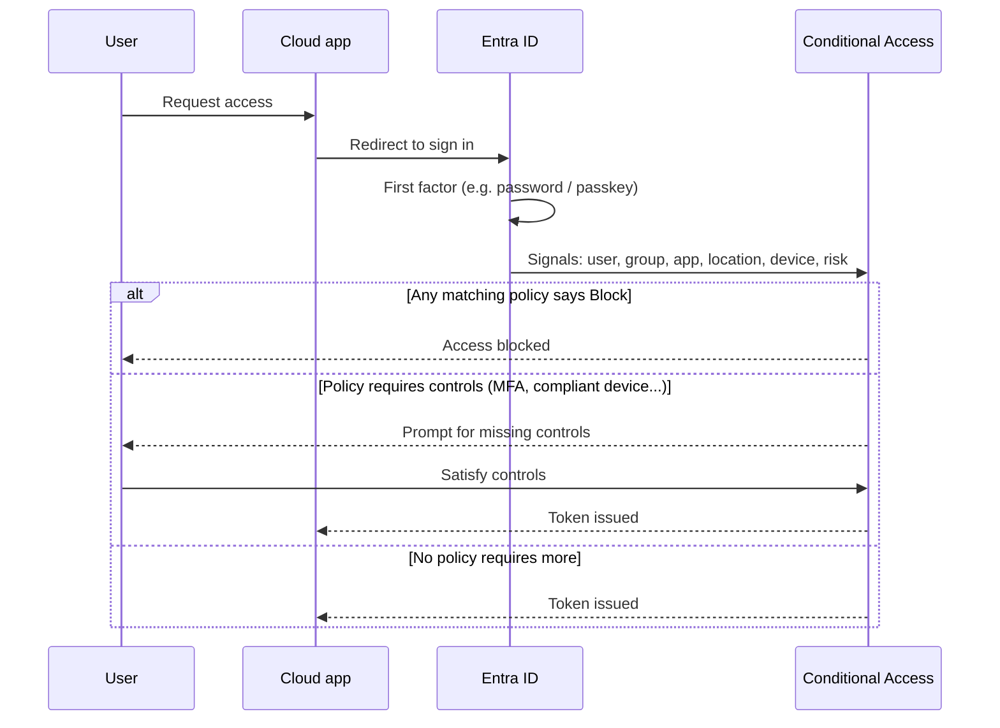

# SC-900 Track – Security, Compliance and Identity Fundamentals

**Level:** beginner. **Format:** concept guide + one runnable teaching simulator.
**Status label:** 📚 Educational content written from the author's own understanding; the technical claims link to official docs (see [docs/references.md](../docs/references.md)). 🧪 The simulator is a *simulation* of an idea, not Microsoft's engine.

> Not exam dumps. These notes and questions are original. Always compare against the current [official SC-900 study guide](https://learn.microsoft.com/credentials/certifications/resources/study-guides/sc-900) because the skills measured change.

## 1. Security fundamentals
- **CIA triad** – *Confidentiality* (only the right people see data), *Integrity* (data is not changed improperly), *Availability* (systems work when needed). Every control you meet protects at least one of these.
- **Defense in depth** – several independent layers (identity, device, network, application, data) so one failure does not mean total compromise.
- **Shared responsibility** – in the cloud the provider secures the underlying infrastructure; *you* always remain responsible for your data, identities and access decisions. How much else you own shifts between IaaS, PaaS and SaaS.
- **Zero Trust** – three guiding principles: *verify explicitly*, *use least-privilege access*, *assume breach*. A VPN or "being inside the office" does not by itself make a request trustworthy.

## 2. Identity concepts
| Concept | Plain-English meaning | Example |
|---|---|---|
| Identity | Something that can be authenticated: a person, a device, an app | `alice@contoso.example` |
| **Authentication (AuthN)** | Proving *who you are* | Password + approval in an authenticator app |
| **Authorization (AuthZ)** | Deciding *what you may do* after you are known | Alice may read the Finance site but not edit billing |
| Identity provider (IdP) | The service that authenticates and issues tokens | Microsoft Entra ID |
| Federation | Trusting another IdP's authentication result | Signing in to a partner app with your work account |

**Microsoft Entra ID** (formerly Azure Active Directory) is Microsoft's cloud identity and access management service. Core objects: *users, groups, applications (service principals), devices, roles*. Apps and Azure resources that need to call other services should use **managed identities** rather than stored passwords.

## 3. Authentication and MFA
Three factor types: **something you know** (password, PIN), **something you have** (phone, security key), **something you are** (fingerprint, face). **MFA** requires at least two *different* types – two passwords is not MFA.

Methods differ in strength. In general, phishing-resistant methods (FIDO2 security keys, passkeys, Windows Hello for Business) are stronger than app notifications, which are stronger than SMS/voice codes. **Passwordless** removes the password entirely and is a major defence against phishing and password spray (see the [SC-200 lab](../SC-200/README.md)).

## 4. Conditional Access (CA)
Conditional Access is Entra's policy engine for access decisions, best thought of as **if-then rules**:



Key ideas:
- **Signals** feed the decision (who, what app, from where, which device, how risky).
- **Decisions** are *block* or *grant with requirements* (MFA, compliant device, etc.).
- **Report-only mode** lets you see the effect of a policy before enforcing it.
- Keep at least one carefully protected **emergency (break-glass) account** excluded from policies, so a bad policy cannot lock everyone out.
- Licensing differs by feature (for example, risk-based conditions need Entra ID Protection). Check the [official Conditional Access overview](https://learn.microsoft.com/entra/identity/conditional-access/overview) for current requirements.

## 5. Compliance and the wider Microsoft security stack (orientation)
| Area | What it is for |
|---|---|
| **Microsoft Purview** | Data governance, classification (sensitivity labels), data loss prevention, retention, eDiscovery, compliance management |
| **Microsoft Defender** family | Threat protection for endpoints, email/collaboration, identities, cloud apps and cloud workloads, unified in **Defender XDR** |
| **Microsoft Sentinel** | Cloud-native SIEM and SOAR: collects logs, detects, investigates and automates response |
| **Microsoft Entra** | Identity and access (workforce identities, governance, external access) |

## 6. Lab: trace a sign-in decision (offline, 10 minutes)
Run the teaching simulator:
```bash
python SC-900/ca_simulator.py
```
Open [`ca_simulator.py`](ca_simulator.py) and do these exercises:
1. A user in group `Admins` signs in to `Finance Portal` from an unmanaged device without MFA. Predict the result, then run it. *(Expected: grant-with-controls, unmet `mfa` and `compliant_device`.)*
2. Set `sign_in_risk="high"` – which rule wins and why? *(Block always wins in this model.)*
3. Add a policy that blocks sign-ins from a country you never operate in. What exclusions would you add for travelling staff?
4. Write one sentence explaining why the emergency account must be excluded from policies and monitored heavily instead.

**Limits of the simulator:** it ignores report-only mode, session controls, authentication strengths, device-filter rules and token behaviour. It exists only to teach the idea. Tests: `tests/test_labs.py`.

## 7. Check your understanding (original questions)
1. Alice proves her identity with a password and a one-time code from an authenticator app. Which two factor types are used? → *Something you know and something you have.*
2. After sign-in, Alice can open a file but cannot delete it. Is that authentication or authorization? → *Authorization.*
3. Why is "everyone on the corporate network is trusted" a poor model under Zero Trust? → *Network location alone does not verify the user or device, and an attacker who gets inside inherits trust ("assume breach").*
4. A Conditional Access policy requires MFA, another blocks high-risk sign-ins. A high-risk user signs in with MFA. What happens? → *Blocked – a block decision overrides grant requirements.*
5. Name one risk of a policy that applies to *all users and all apps* with no exclusions. → *Lockout of all admins (no emergency account), or breaking service accounts.*

## 8. Official references
- [SC-900 study guide](https://learn.microsoft.com/credentials/certifications/resources/study-guides/sc-900)
- [Conditional Access overview](https://learn.microsoft.com/entra/identity/conditional-access/overview)
- [How Microsoft Entra MFA works](https://learn.microsoft.com/entra/identity/authentication/concept-mfa-howitworks)
- [Managed identities overview](https://learn.microsoft.com/entra/identity/managed-identities-azure-resources/overview)
- More in [docs/references.md](../docs/references.md)
