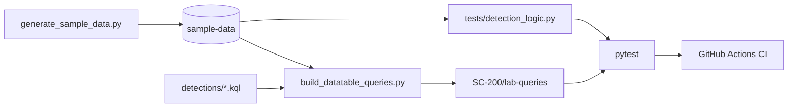
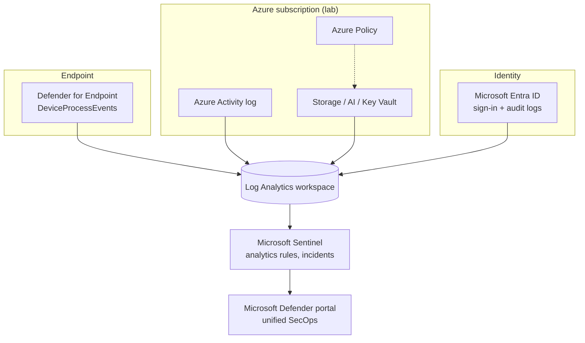

# Architecture

## Repository data flow

Design principles: reproducible (everything generated or tested by script), honest (status labels on every artifact), safe (synthetic data only, secret scanning in tests).

## Target cloud environment (optional lab)

Note: Microsoft has stated the Azure-portal management experience for Sentinel sunsets on 31 March 2027; plan for the Defender portal ([references](references.md)). Defender-portal Advanced Hunting uses `Timestamp`, whereas Log Analytics uses `TimeGenerated`.

## Table-to-detection map
| Table | Detections |
|---|---|
| SigninLogs | 01, 02 |
| AuditLogs | 03 |
| DeviceProcessEvents | 04 |
| AzureActivity | 05, 06 |
